# Flusso della skill gta6-clipping

Diagramma in [Mermaid](https://mermaid.js.org): è testo, quindi si modifica in qualsiasi editor.
Per vederlo e modificarlo graficamente: incolla il blocco su <https://mermaid.live>.
GitHub lo disegna da solo quando apri questo file.

```mermaid
flowchart TD
    %% ---------- AVVIO ----------
    A([Avvio: gta6clip URL oppure --find]) --> B{Controlli iniziali<br/>chiavetta collegata?<br/>Mac ≥ 5 GB, chiavetta ≥ 2 GB?<br/>ffmpeg con sottotitoli?}
    B -- no --> B1[/Stop con messaggio chiaro<br/>niente viene scritto/]
    B -- sì --> C[Legge i dati dello stream<br/>titolo, streamer, durata, live o VOD]
    C --> D{Che pezzo elaborare?}
    D -- "--section A-B" --> D1[Solo quel pezzo]
    D -- VOD --> D2[Tutto lo stream<br/>salta i momenti già clippati]
    D -- live --> D3[Da dove era arrivato<br/>meno 90 s di sovrapposizione]

    %% ---------- ASCOLTO ----------
    D1 & D2 & D3 --> E[Ascolto<br/>scarica SOLO l'audio, riprende se interrotto]
    E --> E1[Volume: picchi al secondo<br/>senza contare il silenzio]
    E --> E2[Trascrizione<br/>sottotitoli della piattaforma,<br/>altrimenti Whisper tiny]
    E --> E3[Chat: momenti di esplosione<br/>se c'è la chat registrata]

    %% ---------- SCELTA ----------
    E1 & E2 & E3 --> F[Scelta con Claude<br/>blocchi da 12 min, 4 alla volta<br/>tempi in secondi assoluti<br/>max 12 picchi LOUD per blocco]
    F --> F0{Tutte le chiamate<br/>a Claude fallite?}
    F0 -- sì --> X1[/Stream FALLITO<br/>cartella di lavoro tenuta,<br/>niente stato salvato/]
    F0 -- no --> G[Tiene i 2×N migliori<br/>con almeno 60 s di distanza]

    %% ---------- CONTROLLO VISIVO ----------
    G --> H[Controllo visivo<br/>4 fotogrammi a 360p per momento<br/>Claude ne guarda 5 per volta]
    H --> H1{È gameplay?<br/>non menu, pubblicità, BRB}
    H1 -- no --> H2[Scartato]
    H1 -- sì --> I[Tiene i migliori N]

    %% ---------- PER OGNI CLIP ----------
    I --> J[[Per ogni clip]]
    J --> J1[Scarica solo quei secondi in 1080p<br/>±2 s di margine]
    J1 --> J2{Facecam trovata?<br/>volto fisso, piccolo,<br/>vicino a un bordo}
    J2 -- sì --> L1[Layout stream<br/>facecam sopra, gioco sotto]
    J2 -- "volto grande" --> L2[Layout face<br/>segue il volto]
    J2 -- no --> L3[Layout fit<br/>video intero su sfondo sfocato]
    L1 & L2 & L3 --> K[Sottotitoli parola per parola<br/>Whisper base, parola attiva gialla]
    K --> K1{Lingua inglese<br/>e trascrizione affidabile?}
    K1 -- no --> K2[Segnalata ⚠ da controllare]
    K1 -- sì --> M
    K2 --> M[Montaggio 1080×1920<br/>barra hook, @streamer, −14 LUFS<br/>schiarisce se troppo buia]
    M --> M0{Clip riuscita?}
    M0 -- no --> M1[Saltata, le altre continuano]
    M0 -- sì --> N

    %% ---------- ARCHIVIO ----------
    N[Archivio sulla chiavetta<br/>solo dentro Cartella di Claude<br/>NN.mp4 numerate di seguito<br/>POST_ora.md, clips_ora.json, report_ora.json]
    N --> N1[Copia sicura: file .part,<br/>controllo dimensione, mai sovrascrive]
    N1 --> O[Salva lo stato per le live]
    O --> P[Pulisce la cartella di lavoro sul Mac]
    P --> Q([Fine: rivedi le clip e pubblica tu<br/>Claude non pubblica mai])

    %% ---------- STILI ----------
    classDef stop fill:#fde2e2,stroke:#c0392b,color:#000;
    classDef claude fill:#e8e1fb,stroke:#6c4fd3,color:#000;
    classDef stick fill:#dff3e4,stroke:#2e8b57,color:#000;
    class B1,X1 stop;
    class F,H claude;
    class N,N1,O stick;
```

**Legenda colori:** viola = passi in cui lavora Claude (senza strumenti né connettori; nel controllo visivo legge solo i fotogrammi) · verde = scritture sulla chiavetta · rosso = stop sicuri.
